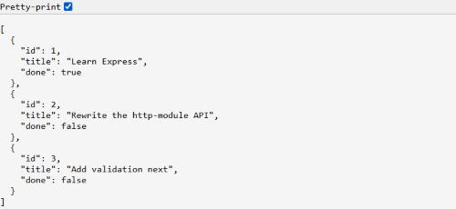
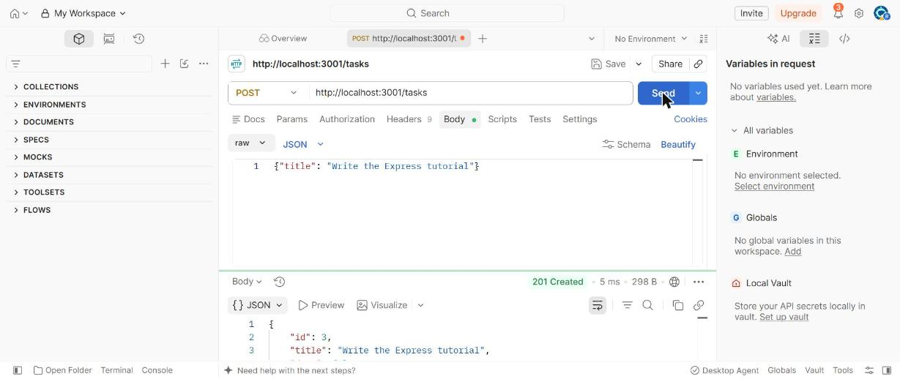
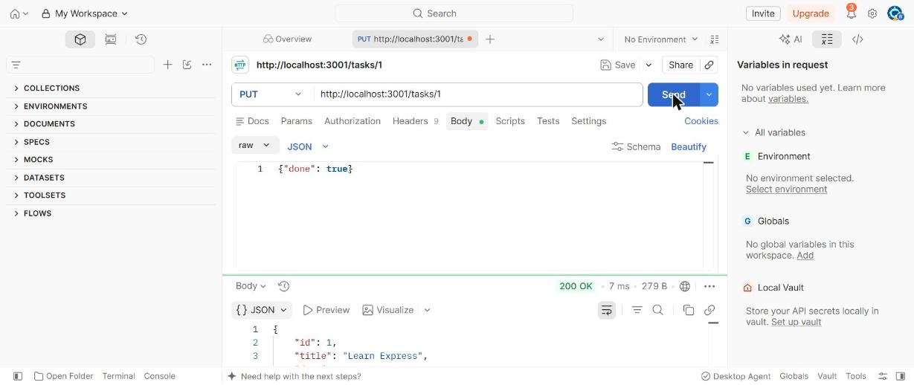
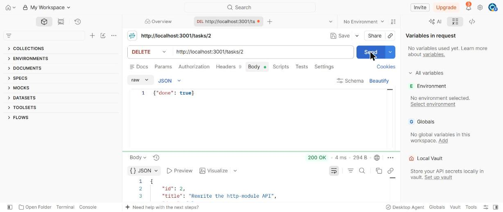
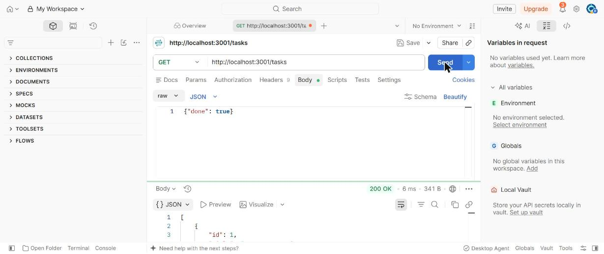

# Build a REST API with Express

The previous tutorial built a small Tasks API with nothing but Node's `http` module, and
along the way hit three real annoyances: routing by hand with `if` statements, parsing a
JSON body one chunk at a time, and writing `writeHead`/`end` for every single response.
**Express** is a framework that exists specifically to make all three of those
disappear. This tutorial rebuilds the *exact same* API in Express — same routes, same
behavior — so you can see directly, line by line, what a framework actually buys you.

!!! tip "Download the code"
    **[⬇ Download express-server.zip](../../downloads/tutorial-code/express-server.zip)**
    — unzip it, run `npm install` inside the folder to pull down Express, then
    `node server.js`. Part 6 walks through exactly what it does.

**Prerequisites:** [Build a Server with Node's http Module](node-http-server.md) — this
tutorial directly compares against it — and
[npm and Package Management](../devops/npm-and-package-management.md).

## In This Tutorial

- Install Express and start the smallest possible app
- Define routes with `app.get`, `app.post`, `app.put`, and `app.delete` — one line each
- Read route parameters with `req.params`, no regex required
- Parse a JSON request body automatically with `express.json()`
- Add a catch-all 404 handler
- Rebuild the full Tasks API — now with `PUT` and `DELETE` too — and run it for real

---

## Part 1: Install Express and Say Hello

```bash
npm install express
```

```javascript
const express = require("express");

const app = express();

app.get("/", (req, res) => {
  res.send("Hello from Express!");
});

app.listen(3000, () => {
  console.log("Listening on http://localhost:3000");
});
```

`express()` creates an **app** — an object representing your whole server.
`app.get(path, handler)` registers a handler that runs only for `GET` requests to that
exact path; compare that to the raw `http` version's `if (req.method === "GET" &&
req.url === "/") { ... }`, now gone entirely. `res.send(text)` is Express's version of
`res.end(text)` — it also sets a sensible `Content-Type` automatically based on what you
pass it.

## Part 2: JSON Responses, Automatically

```javascript
app.get("/tasks", (req, res) => {
  res.json([{ id: 1, title: "Learn Express" }]);
});
```

`res.json(data)` does everything the raw-`http` version's `sendJson` helper did by
hand — `JSON.stringify`, the `Content-Type: application/json` header, the correct
`Content-Length` — in one call, with the status defaulting to `200`. Need a different
status code? Chain `.status()` first: `res.status(201).json(newTask)`.

## Part 3: Route Parameters

```javascript
app.get("/tasks/:id", (req, res) => {
  const id = Number(req.params.id);
  res.json({ requestedId: id });
});
```

The `:id` in the path is a **route parameter** — Express matches it against whatever's
actually in the URL and hands it to you, already extracted, as `req.params.id` (always
a string, which is why it's wrapped in `Number(...)` to compare against the numeric
`id`s in the `tasks` array). This is the exact thing the raw `http` version needed a
hand-written regular expression for.

## Part 4: Reading the Request Body

```javascript
app.use(express.json());

app.post("/tasks", (req, res) => {
  console.log(req.body); // already a real object -- no manual parsing
  res.status(201).json({ received: req.body });
});
```

`app.use(express.json())` registers **middleware** — code that runs on every request
before your route handlers do. This particular middleware reads the request body,
parses it as JSON, and attaches the result to `req.body` — replacing the raw version's
entire `readJsonBody` function (the `data`/`end` event listeners, the `Buffer.concat`,
all of it) with one line, run once, for the whole app.

!!! note "Middleware order matters"
    `app.use(express.json())` has to run **before** any route handler that reads
    `req.body` — Express runs middleware and routes in the order you register them, top
    to bottom. Put it near the top of the file, before your routes.

## Part 5: A Catch-All 404

```javascript
app.use((req, res) => {
  res.status(404).json({ error: `No route for ${req.method} ${req.originalUrl}` });
});
```

Registered with `app.use()` and no path, this runs for any request that didn't match a
route above it — Express's equivalent of the raw version's final `sendJson(res, 404,
...)` fallback. It has to be the **last** thing registered, for the same reason
middleware order matters above: Express tries routes top to bottom and stops at the
first match.

## Part 6: The Complete Tasks API — Now with Full CRUD

```javascript
const express = require("express");

const app = express();
app.use(express.json()); // parses a JSON request body into req.body -- no manual chunk-reading needed

let tasks = [
  { id: 1, title: "Learn Express", done: false },
  { id: 2, title: "Rewrite the http-module API", done: false },
];
let nextId = 3;

app.get("/tasks", (req, res) => {
  res.json(tasks);
});

app.get("/tasks/:id", (req, res) => {
  const task = tasks.find((t) => t.id === Number(req.params.id));
  if (!task) return res.status(404).json({ error: "Task not found" });
  res.json(task);
});

app.post("/tasks", (req, res) => {
  const { title } = req.body;
  if (!title || typeof title !== "string") {
    return res.status(400).json({ error: "'title' is required" });
  }
  const newTask = { id: nextId++, title, done: false };
  tasks.push(newTask);
  res.status(201).json(newTask);
});

app.put("/tasks/:id", (req, res) => {
  const task = tasks.find((t) => t.id === Number(req.params.id));
  if (!task) return res.status(404).json({ error: "Task not found" });
  if (typeof req.body.title === "string") task.title = req.body.title;
  if (typeof req.body.done === "boolean") task.done = req.body.done;
  res.json(task);
});

app.delete("/tasks/:id", (req, res) => {
  const index = tasks.findIndex((t) => t.id === Number(req.params.id));
  if (index === -1) return res.status(404).json({ error: "Task not found" });
  const [deleted] = tasks.splice(index, 1);
  res.json(deleted);
});

// Runs for any URL/method that didn't match a route above.
app.use((req, res) => {
  res.status(404).json({ error: `No route for ${req.method} ${req.originalUrl}` });
});

const PORT = 3001;
app.listen(PORT, () => {
  console.log(`Tasks API (Express) listening on http://localhost:${PORT}`);
});
```

Line for line, this is noticeably shorter than the raw `http` version — and it gained
`PUT` and `DELETE`, which would have needed two more hand-written `if` blocks and two
more regex matches to add there.

### Running It and Trying Every Route

```bash
node server.js
```

```text
Tasks API (Express) listening on http://localhost:3001
```

```bash
curl -X PUT http://localhost:3001/tasks/1 \
  -H "Content-Type: application/json" \
  -d '{"done":true}'
```

```json
{"id":1,"title":"Learn Express","done":true}
```

```bash
curl -X DELETE http://localhost:3001/tasks/2
```

```json
{"id":2,"title":"Rewrite the http-module API","done":false}
```

```bash
curl http://localhost:3001/tasks
```

```json
[{"id":1,"title":"Learn Express","done":true},{"id":3,"title":"Write the Express tutorial","done":false}]
```

Here's that final `GET /tasks` after a `PUT`, a `POST`, and a `DELETE`, open in a
browser:



### Testing with Postman

`curl` is fast once you know the flags, but **Postman** makes the same CRUD workflow
easier to see and repeat while you're still learning it: every field — method, URL,
headers, body — is its own labeled box on screen, and the response is highlighted and
collapsible instead of one unbroken line of terminal text.

**`POST /tasks`** — set the method to `POST` and the URL to
`http://localhost:3001/tasks`. Open the **Body** tab, select **raw**, pick **JSON** from
the format dropdown, and type:

```json
{"title": "Write the Express tutorial"}
```

Click **Send**: Express's `express.json()` middleware parses this exactly the same way
it would parse a body from `curl -d`, and the new task comes back with `201 Created`:



**`PUT /tasks/1`** — switch the method to `PUT`, point the URL at `/tasks/1`, and set the
body to `{"done": true}`. The response shows task 1 with `done` flipped to `true`:



**`DELETE /tasks/2`** — switch the method to `DELETE` and point the URL at `/tasks/2`.
No body needed; the response echoes back the task that just got removed:



**`GET /tasks`** (final check) — switch back to `GET` with no body, and the list now
reflects every change made above: task 1 updated, task 2 gone, task 3 added.



!!! tip "Save these as a collection"
    Postman lets you save each request into a **Collection** so you don't have to
    retype the method, URL, and body every time you want to re-test this API — click
    **Save** next to the Send button once, and every request you build after that can
    be reopened from the sidebar instead of rebuilt from scratch.

## Try It Yourself

1. Add input validation to `PUT /tasks/:id` the same way `POST /tasks` validates
   `title` — right now, `PUT` silently accepts a `title` of any type as long as it
   passes the `typeof === "string"` check, but never rejects a request that sends
   *neither* `title` nor `done`.
2. Add a second catch-all, this time for errors: wrap each route's body in `try/catch`
   and call `next(error)`, then add a 4-argument error-handling middleware
   (`(err, req, res, next) => {...}`) at the very end that responds with `500` — Express
   recognizes a 4-argument middleware function specifically as an error handler.
3. Count the total lines in this file versus the raw `http` version from the previous
   tutorial, for the same four routes (`GET` list, `GET` one, `POST`, plus the 404
   fallback) — then imagine adding six more routes to each, and consider how that gap
   would grow.

## Key Takeaways

- `app.get/post/put/delete(path, handler)` replace hand-written `if (req.method === ...
  && req.url === ...)` checks entirely — Express matches the method and path for you.
- `req.params.id` gives you a route parameter already extracted — no regular expression
  needed, unlike the raw `http` version.
- `app.use(express.json())` is **middleware**: code that runs on every request before
  your routes do. Order matters — register it before any route that reads `req.body`.
- `res.json(data)` and `res.status(code).json(data)` replace an entire hand-written
  `sendJson` helper, with the same guarantees (correct `Content-Type`, correct body).
- A final `app.use((req, res) => {...})` with no path is Express's catch-all 404 —
  register it **last**, since Express checks routes in registration order and stops at
  the first match.
