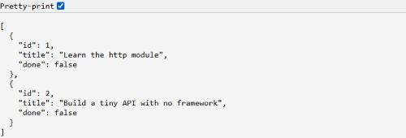
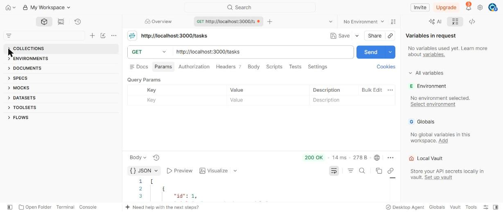
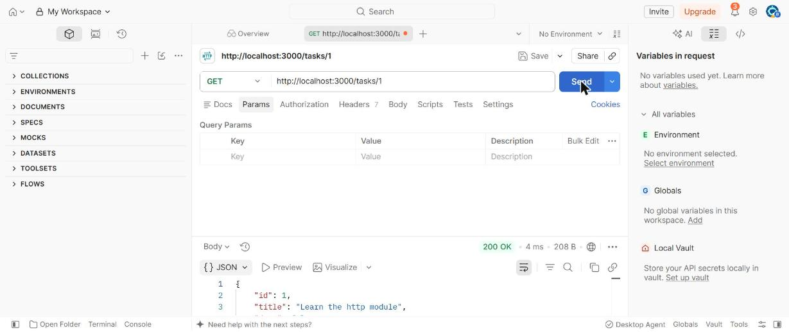
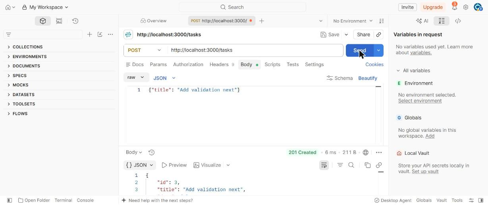

# Build a Server with Node's http Module

Every tutorial in this course so far has run entirely in a browser. This one is the
first to run somewhere else: a terminal, as a process that stays alive and listens for
requests. Before reaching for Express (the very next tutorial), it's worth building one
tiny API with **nothing but Node's built-in `http` module** — no framework, no
dependencies at all — so you can actually see what a framework like Express is doing for
you, instead of taking it on faith.

!!! tip "Download the code"
    Every file this tutorial builds is available as a ready-to-run project:
    **[⬇ Download node-http-server.zip](../../downloads/tutorial-code/node-http-server.zip)**.
    Unzip it, run `npm install` inside the folder (there's nothing to install yet, but
    it's the habit to build), then `node server.js` — Part 5 walks through exactly what
    it does.

**Prerequisites:** [npm and Package Management](../devops/npm-and-package-management.md)
and [Core JavaScript (ES6+)](../../web-technologies/lecture-11-core-javascript-es6.md).
No prior backend experience assumed — this tutorial is where that starts.

## In This Tutorial

- Create the simplest possible Node server: `http.createServer()` and `.listen()`
- Understand the `request` and `response` objects every request handler receives
- Send JSON back with the right status code and headers, by hand
- Route by `req.method` and `req.url` yourself — there's no router to do it for you
- Read and parse a POST request's body one chunk at a time
- Build a small, complete Tasks API, then run it and see it respond for real

---

## Part 1: The Simplest Possible Server

```javascript
const http = require("http");

const server = http.createServer((req, res) => {
  res.end("Hello from Node!");
});

server.listen(3000, () => {
  console.log("Listening on http://localhost:3000");
});
```

`http.createServer()` takes one function — called a **request handler** — and runs it
every single time a request arrives, for *any* URL, with *any* method. `req` describes
what came in (method, URL, headers, body); `res` is how you reply. `res.end(text)` sends
`text` as the complete response body and closes the connection. `.listen(3000)` starts
the server listening on port 3000 and doesn't return — the process just stays alive,
waiting.

Save this as `server.js` and run it:

```bash
node server.js
```

```text
Listening on http://localhost:3000
```

The terminal doesn't give you your prompt back — that's expected, the server is still
running. Visit `http://localhost:3000` in a browser (any path works right now — nothing
checks the URL yet) and you'll see `Hello from Node!`. Stop it with `Ctrl+C` when you're
done looking.

## Part 2: Sending JSON, with the Right Headers

A real API sends JSON, not plain text, and needs to say so:

```javascript
const http = require("http");

const server = http.createServer((req, res) => {
  const body = JSON.stringify({ message: "Hello from Node!" });
  res.writeHead(200, { "Content-Type": "application/json" });
  res.end(body);
});

server.listen(3000, () => {
  console.log("Listening on http://localhost:3000");
});
```

`res.writeHead(statusCode, headers)` sets the HTTP status code and any response headers
**before** you call `res.end()` — once the body starts going out, headers can't change
anymore. `Content-Type: application/json` tells whatever's reading the response "parse
this as JSON," the same header Lecture 15's Fetch API examples checked for on the way
in.

## Part 3: Routing by Hand

`req.method` and `req.url` are the only two things `http` gives you to decide what a
request is asking for — there's no `app.get("/tasks", ...)` here, you write the `if`
statements yourself:

```javascript
const http = require("http");

function sendJson(res, statusCode, data) {
  const body = JSON.stringify(data);
  res.writeHead(statusCode, {
    "Content-Type": "application/json",
    "Content-Length": Buffer.byteLength(body),
  });
  res.end(body);
}

const server = http.createServer((req, res) => {
  if (req.method === "GET" && req.url === "/tasks") {
    return sendJson(res, 200, [{ id: 1, title: "Learn the http module" }]);
  }

  sendJson(res, 404, { error: `No route for ${req.method} ${req.url}` });
});

server.listen(3000, () => {
  console.log("Listening on http://localhost:3000");
});
```

`sendJson` is a small helper that bundles the three things every JSON response needs
(stringify the body, set the content type, set an accurate `Content-Length`) so the
actual routing logic below it stays readable. The very last line — `sendJson(res, 404,
...)` — matters as much as the routes above it: without a catch-all, a request to a URL
nothing handles would hang forever, since nothing would ever call `res.end()`.

!!! note "A route with an `:id` in it needs a regular expression"
    `req.url` is a flat string — `/tasks/7` is just the seven characters after
    `/tasks/`, with nothing pulling `7` out for you automatically the way Express's
    `req.params.id` will in the next tutorial. Part 5 shows the regex that does it by
    hand: `url.match(/^\/tasks\/(\d+)$/)`.

## Part 4: Reading a POST Body

`req` is a **stream** — its data doesn't all arrive at once, it arrives in pieces
(`chunks`) over time, and you assemble it yourself:

```javascript
function readJsonBody(req) {
  return new Promise((resolve, reject) => {
    const chunks = [];
    req.on("data", (chunk) => chunks.push(chunk));
    req.on("end", () => {
      try {
        resolve(JSON.parse(Buffer.concat(chunks).toString()));
      } catch (error) {
        reject(error);
      }
    });
    req.on("error", reject);
  });
}
```

`req.on("data", ...)` fires once per chunk as it arrives; `req.on("end", ...)` fires
once, after the very last chunk, when the whole body has arrived. `Buffer.concat(chunks)`
joins every chunk into one buffer, `.toString()` turns that into text, and `JSON.parse`
turns the text into a real object — the exact same end result `express.json()` gives you
for free, which is the whole point of showing it done by hand once.

## Part 5: The Complete Tasks API

Everything above, combined into one small, real API — `GET /tasks`, `GET /tasks/:id`,
and `POST /tasks`, with an in-memory array standing in for a database:

```javascript
const http = require("http");

// In-memory data -- resets every time the server restarts. No database yet;
// that comes in a later lecture/tutorial. Each task is { id, title, done }.
let tasks = [
  { id: 1, title: "Learn the http module", done: false },
  { id: 2, title: "Build a tiny API with no framework", done: false },
];
let nextId = 3;

function sendJson(res, statusCode, data) {
  const body = JSON.stringify(data);
  res.writeHead(statusCode, {
    "Content-Type": "application/json",
    "Content-Length": Buffer.byteLength(body),
  });
  res.end(body);
}

function readJsonBody(req) {
  return new Promise((resolve, reject) => {
    const chunks = [];
    req.on("data", (chunk) => chunks.push(chunk));
    req.on("end", () => {
      if (chunks.length === 0) return resolve({});
      try {
        resolve(JSON.parse(Buffer.concat(chunks).toString()));
      } catch (error) {
        reject(error);
      }
    });
    req.on("error", reject);
  });
}

const server = http.createServer(async (req, res) => {
  const { method, url } = req;

  if (method === "GET" && url === "/tasks") {
    return sendJson(res, 200, tasks);
  }

  const singleTaskMatch = url.match(/^\/tasks\/(\d+)$/);
  if (method === "GET" && singleTaskMatch) {
    const id = Number(singleTaskMatch[1]);
    const task = tasks.find((t) => t.id === id);
    if (!task) return sendJson(res, 404, { error: "Task not found" });
    return sendJson(res, 200, task);
  }

  if (method === "POST" && url === "/tasks") {
    let body;
    try {
      body = await readJsonBody(req);
    } catch (error) {
      return sendJson(res, 400, { error: "Invalid JSON body" });
    }
    if (!body.title || typeof body.title !== "string") {
      return sendJson(res, 400, { error: "'title' is required" });
    }
    const newTask = { id: nextId++, title: body.title, done: false };
    tasks.push(newTask);
    return sendJson(res, 201, newTask);
  }

  sendJson(res, 404, { error: `No route for ${method} ${url}` });
});

const PORT = 3000;
server.listen(PORT, () => {
  console.log(`Tasks API (raw http module) listening on http://localhost:${PORT}`);
});
```

### Running It and Trying Every Route

```bash
node server.js
```

```text
Tasks API (raw http module) listening on http://localhost:3000
```

In a second terminal, `curl` every route in turn (a browser address bar can only do
`GET`, so `POST` needs a tool like `curl`, Postman, or the Fetch API from Lecture 15):

```bash
curl http://localhost:3000/tasks
```

```json
[{"id":1,"title":"Learn the http module","done":false},{"id":2,"title":"Build a tiny API with no framework","done":false}]
```

```bash
curl -X POST http://localhost:3000/tasks \
  -H "Content-Type: application/json" \
  -d '{"title":"Write the tutorial"}'
```

```json
{"id":3,"title":"Write the tutorial","done":false}
```

```bash
curl http://localhost:3000/tasks/1
```

```json
{"id":1,"title":"Learn the http module","done":false}
```

```bash
curl -i http://localhost:3000/tasks/999
```

```text
HTTP/1.1 404 Not Found
Content-Type: application/json

{"error":"Task not found"}
```

Here's `GET /tasks` opened directly in a browser:



### Testing with Postman

A browser address bar can only send `GET` requests, and typing a `curl` command gets
tedious fast once you're testing several routes back and forth. **Postman** is a GUI
app built exactly for this: pick a method, type a URL, fill in a body if you need one,
and click **Send** — no terminal required.

**`GET /tasks`** — set the method dropdown to `GET`, type
`http://localhost:3000/tasks` into the URL bar, and click **Send**. The response panel
at the bottom shows the status (`200 OK`) and the JSON body, nicely color-highlighted:



**`GET /tasks/1`** — route parameters work the same way as any other URL; just type the
id straight into the path:



**`POST /tasks`** — this is where Postman earns its keep over a browser. Switch the
method dropdown to `POST`, then open the **Body** tab below the URL bar, select **raw**,
and choose **JSON** from the format dropdown on the right. Type the request body as
JSON (Postman sets the `Content-Type: application/json` header for you automatically
when you pick "JSON"):

```json
{"title": "Add validation next"}
```

Click **Send**, and the new task comes back with `201 Created` and the `id` the server
assigned it:



## Try It Yourself

1. Add a `DELETE /tasks/:id` route yourself, reusing the same `singleTaskMatch` regex
   pattern from `GET /tasks/:id`. Remove the matching task from the `tasks` array with
   `.filter()` or `.splice()`, and respond with the deleted task.
2. The current `POST /tasks` handler never checks that the request's `Content-Type` is
   actually `application/json` before trying to parse it. Add that check, and respond
   with `415 Unsupported Media Type` (a real HTTP status code) if it's missing.
3. Time how long it takes you to add one new route by hand versus how long the same
   route takes in the next tutorial's Express version — write down the difference before
   you forget it.

## Key Takeaways

- `http.createServer(handler)` runs `handler(req, res)` for **every** request, no matter
  the method or URL — routing, JSON parsing, and body reading are all things *you* write,
  not things the module gives you.
- `res.writeHead(status, headers)` must be called before `res.end(body)` — headers can't
  change once the response body starts.
- `req.url` and `req.method` are the only built-in way to tell requests apart; a route
  parameter like `:id` needs a hand-written regular expression to extract.
- `req` is a stream — its body arrives in `data` events, one chunk at a time, and isn't
  complete until the `end` event fires.
- Every one of these manual steps (routing, JSON responses, body parsing) is exactly
  what a framework like Express automates — which is easiest to appreciate once you've
  written it by hand at least once.
