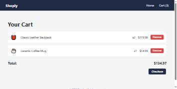

# Convert a Static Site to Express + EJS

A very common real task is **not** building a dynamic site from a blank folder — it's
starting with a static HTML/CSS/JS site someone already built (maybe you, maybe a
designer) and turning it into something a real backend can drive. This tutorial does
exactly that: a 3-page static storefront, **Shoply**, converted into an Express + EJS
app with **express-ejs-layouts** — keeping almost all of the original CSS and
client-side JavaScript completely untouched, and removing the duplication a
multi-page static site can't avoid.

!!! tip "Download the code"
    **[⬇ Download static-ecommerce.zip](../../downloads/tutorial-code/static-ecommerce.zip)**
    — the starting point: open `index.html` directly in a browser, no server needed.
    **[⬇ Download express-ecommerce-ejs.zip](../../downloads/tutorial-code/express-ecommerce-ejs.zip)**
    — the finished conversion: unzip, `npm install`, then `node server.js`. Part 7 walks
    through every file inside it.

**Prerequisites:** [EJS Views and express-ejs-layouts](ejs-views-and-layouts.md) — this
tutorial assumes you already know `<%= %>`/`<%- %>`, partials, and how
express-ejs-layouts wraps a page in a shared shell; here that knowledge gets applied to
a *real* multi-page conversion instead of an app built EJS-first from scratch.

## In This Tutorial

- Spot exactly what a static multi-page site duplicates, and why it can't avoid it
- Set up Express + EJS + express-ejs-layouts, reusing the static site's CSS unchanged
- Pull a header/nav/footer repeated in **three separate HTML files** into one layout
- Turn four copy-pasted product cards into a single loop over real data
- Convert a page that read `?id=` from its own URL in the browser into a real
  `/products/:id` route handled on the server
- Decide what does **not** need to move to the server — and why

---

## Part 1: The Static Site

Shoply starts as three plain HTML files, a stylesheet, and a few small scripts:

```text
static-ecommerce/
├── index.html         (product listing)
├── product.html        (product detail)
├── cart.html           (shopping cart)
├── css/style.css
└── js/
    ├── products.js     (the product catalog, as a hardcoded array)
    ├── cart.js         (cart logic, stored in localStorage)
    └── product-page.js (reads ?id= from the URL for product.html)
```

Open any of the three HTML files and the same block appears, character-for-character
identical, at the top and bottom of each one:

```html title="the same markup, copy-pasted into index.html, product.html, AND cart.html"
<header>
  <div class="logo"><a href="index.html">Shoply</a></div>
  <nav>
    <a href="index.html">Home</a>
    <a href="cart.html">Cart (<span id="cart-count">0</span>)</a>
  </nav>
</header>

<!-- ... page-specific content goes here ... -->

<footer>
  &copy; 2026 Shoply. All rights reserved.
</footer>
```

A static multi-page site has no way around this: there's no server to generate each
page, so every `.html` file has to be a complete, self-contained document — which means
anything shared between pages has to be **repeated**, by hand, in every single one.
Change the nav (add a "Sale" link, say) and that's three files to edit, not one.

`index.html` has a second kind of duplication, inside a single file this time — four
nearly-identical product cards, the full card markup copy-pasted and only the name,
price, icon, and id changed each time:

```html title="index.html (trimmed to 2 of the 4 cards)"
<div class="product-card">
  <span class="icon">🎒</span>
  <h3>Classic Leather Backpack</h3>
  <p class="price">$59.99</p>
  <a class="view-btn" href="product.html?id=1">View Details</a>
  <button class="add-to-cart-btn" onclick="addToCart(1)">Add to Cart</button>
</div>
<div class="product-card">
  <span class="icon">🎧</span>
  <h3>Wireless Headphones</h3>
  <p class="price">$89.99</p>
  <a class="view-btn" href="product.html?id=2">View Details</a>
  <button class="add-to-cart-btn" onclick="addToCart(2)">Add to Cart</button>
</div>
<!-- ...two more, same shape, copy-pasted again... -->
```

And `product.html` has no server to tell it *which* product it's showing — so it reads
an `id` out of its own URL's query string and looks it up, in the browser, after the
page has already loaded once with nothing in it:

```javascript title="js/product-page.js"
function renderProductPage() {
  const params = new URLSearchParams(window.location.search);
  const id = Number(params.get("id"));
  const product = PRODUCTS.find((p) => p.id === id);
  const container = document.getElementById("product-detail");

  if (!product) {
    container.innerHTML = "<p>Product not found.</p>";
    return;
  }
  container.innerHTML = `<h1>${product.name}</h1> ...`; // (trimmed)
}

document.addEventListener("DOMContentLoaded", renderProductPage);
```

These three problems — repeated header/footer across files, repeated card markup
within a file, and "look up data from the URL after the page loads" — are exactly what
the rest of this tutorial removes, one Part at a time.

## Part 2: Project Setup

```bash
mkdir express-ecommerce-ejs
cd express-ecommerce-ejs
npm init -y
npm install express ejs express-ejs-layouts
```

```javascript title="server.js (starting point)"
const express = require("express");
const expressLayouts = require("express-ejs-layouts");

const app = express();
app.set("view engine", "ejs");
app.use(expressLayouts);
app.set("layout", "layout"); // views/layout.ejs wraps every page
app.use(express.static("public")); // serves anything under public/ at the site root

const PORT = 3003;
app.listen(PORT, () => {
  console.log(`Shoply (Express + EJS) listening on http://localhost:${PORT}`);
});
```

Copy `css/style.css` into `public/css/style.css` — **completely unchanged**, not one
line edited — and copy `js/cart.js` into `public/js/cart.js` (Part 6 explains the one
small thing that *does* change about it). `express.static("public")` serves everything
under that folder at the site's root, so a `<link>` that used to say
`href="css/style.css"` becomes `href="/css/style.css"` — same file, same CSS, just a
leading slash because the project root and the server root aren't the same folder
anymore.

## Part 3: One Shared Layout Instead of Three Copies

The header/footer block repeated verbatim across all three static pages becomes two
small partials and one layout:

```html title="views/partials/header.ejs"
<header>
  <div class="logo"><a href="/">Shoply</a></div>
  <nav>
    <a href="/">Home</a>
    <a href="/cart">Cart (<span id="cart-count">0</span>)</a>
  </nav>
</header>
```

```html title="views/layout.ejs"
<!DOCTYPE html>
<html lang="en">
<head>
  <meta charset="UTF-8">
  <title><%= typeof title !== "undefined" ? title : "Shoply" %></title>
  <link rel="stylesheet" href="/css/style.css">
</head>
<body>
  <%- include("partials/header") %>
  <main>
    <%- body %>
  </main>
  <%- include("partials/footer") %>
  <script src="/js/cart.js"></script>
</body>
</html>
```

Every route below renders a small view containing only that page's own content — the
header, the `<html>` shell, the footer, and the stylesheet link all live in exactly
**one** file now, no matter how many pages the site grows to.

## Part 4: The Product Listing — From Four Copy-Pasted Cards to One Loop

The four hand-copied `<div class="product-card">` blocks collapse into a single loop,
once the product data lives in one place the server can read:

```javascript title="data/products.js"
module.exports = [
  { id: 1, name: "Classic Leather Backpack", price: 59.99, icon: "🎒", description: "..." },
  { id: 2, name: "Wireless Headphones", price: 89.99, icon: "🎧", description: "..." },
  { id: 3, name: "Ceramic Coffee Mug", price: 14.99, icon: "☕", description: "..." },
  { id: 4, name: "Canvas Sneakers", price: 44.99, icon: "👟", description: "..." },
];
```

```javascript title="server.js (add this route)"
const products = require("./data/products");

app.get("/", (req, res) => {
  res.render("index", { title: "Shoply - Home", products });
});
```

```html title="views/index.ejs"
<div class="product-grid">
  <% products.forEach(function (product) { %>
    <div class="product-card">
      <span class="icon"><%= product.icon %></span>
      <h3><%= product.name %></h3>
      <p class="price">$<%= product.price.toFixed(2) %></p>
      <a class="view-btn" href="/products/<%= product.id %>">View Details</a>
      <button class="add-to-cart-btn" onclick="addToCart(<%= product.id %>)">Add to Cart</button>
    </div>
  <% }); %>
</div>
```

Adding a fifth product now means adding one object to `data/products.js` — the HTML for
its card is generated, not retyped.

## Part 5: The Product Detail Page — From a Query String to a Route Parameter

The static page's client-side lookup becomes a route parameter the server resolves
*before* sending anything back:

```javascript title="server.js (add this route)"
app.get("/products/:id", (req, res) => {
  const product = products.find((p) => p.id === Number(req.params.id));
  if (!product) {
    return res.status(404).render("not-found", { title: "Not Found" });
  }
  res.render("product", { title: `Shoply - ${product.name}`, product });
});
```

```html title="views/product.ejs"
<div class="product-detail">
  <div class="product-detail-icon"><%= product.icon %></div>
  <div class="product-detail-info">
    <h1><%= product.name %></h1>
    <p class="price">$<%= product.price.toFixed(2) %></p>
    <p class="description"><%= product.description %></p>
    <button class="add-to-cart-btn" onclick="addToCart(<%= product.id %>)">Add to Cart</button>
  </div>
</div>
```

Two real improvements fall out of this for free: the URL becomes `/products/2` instead
of `product.html?id=2` (a cleaner, more REST-ish path), and an unknown id now gets a
genuine HTTP `404` status code — `res.status(404).render(...)` — rather than the static
version's page that still returns `200 OK` while displaying the text "Product not
found" inside a perfectly successful response.

## Part 6: What Doesn't Move to the Server — The Cart

Not every page benefits from server rendering. The cart's contents (which products,
what quantity) live in the browser's `localStorage` — there's no database backing it in
this app, so there's nothing for the server to look up. `GET /cart` still just renders
an empty shell that the *same* client-side `cart.js` fills in after the page loads,
exactly like the static version did:

```javascript title="server.js (add this route)"
app.get("/cart", (req, res) => {
  res.render("cart", { title: "Shoply - Cart", products });
});
```

The one real change is *where the product catalog comes from* on this page. The static
site's `js/products.js` was a second, hand-maintained copy of the exact same data
`js/cart.js` needed to show names and prices next to each cart line — easy to let drift
out of sync with the real catalog. The server already has that data in one place, so it
gets handed to the page as JSON instead of redefined:

```html title="views/cart.ejs"
<div id="cart-items"></div>
<script>
  const PRODUCTS = <%- JSON.stringify(products) %>;
</script>
```

`<%-` here, not `<%=` — this needs to produce literal JavaScript array syntax
(`[{"id":1,...}]`), not HTML-escaped text; `<%=` would turn every `"` into `&quot;` and
break the script entirely.

!!! warning "Script order matters"
    `views/layout.ejs` loads `/js/cart.js` at the very end of `<body>`, *after*
    `<%- body %>` — a common pattern, since it lets the rest of the page render first.
    That means a page-specific `<script>` block (like the one above) runs **before**
    `cart.js` has loaded, so any function `cart.js` defines — `renderCartPage()`, for
    example — doesn't exist yet at that point in the page. Writing
    `document.addEventListener("DOMContentLoaded", renderCartPage)` fails with
    `renderCartPage is not defined`, because the reference is looked up immediately, as
    the line runs — not later, when the event actually fires. Wrapping it in an
    anonymous function defers that lookup until `DOMContentLoaded` actually happens, by
    which point `cart.js` has loaded:
    ```javascript
    document.addEventListener("DOMContentLoaded", function () {
      renderCartPage(); // looked up NOW, not when this line first runs
    });
    ```

## Part 7: The Complete Converted App

**`server.js`**

```javascript
const express = require("express");
const expressLayouts = require("express-ejs-layouts");
const products = require("./data/products");

const app = express();
app.set("view engine", "ejs");
app.set("views", "./views");
app.use(expressLayouts);
app.set("layout", "layout");
app.use(express.static("public"));

app.get("/", (req, res) => {
  res.render("index", { title: "Shoply - Home", products });
});

app.get("/products/:id", (req, res) => {
  const product = products.find((p) => p.id === Number(req.params.id));
  if (!product) {
    return res.status(404).render("not-found", { title: "Not Found" });
  }
  res.render("product", { title: `Shoply - ${product.name}`, product });
});

app.get("/cart", (req, res) => {
  res.render("cart", { title: "Shoply - Cart", products });
});

const PORT = 3003;
app.listen(PORT, () => {
  console.log(`Shoply (Express + EJS) listening on http://localhost:${PORT}`);
});
```

`views/layout.ejs`, `views/partials/header.ejs`, and `views/index.ejs` are the files
from Parts 3 and 4 above; `views/product.ejs` and the cart snippet from Parts 5 and 6.
`views/partials/footer.ejs` and `views/not-found.ejs` are small enough to show in full:

```html title="views/partials/footer.ejs"
<footer>
  &copy; 2026 Shoply. All rights reserved.
</footer>
```

```html title="views/not-found.ejs"
<div class="empty-state">
  <h1>Product Not Found</h1>
  <p><a href="/">Back to the shop</a></p>
</div>
```

Every other file — `public/css/style.css`, `public/js/cart.js`, and the full
`views/cart.ejs` — is in the zip at the top of this page.

### Running It

```bash
node server.js
```

```text
Shoply (Express + EJS) listening on http://localhost:3003
```

Open `http://localhost:3003` in a browser:


Click **Add to Cart** on a couple of products, then open the cart:



Same look, same cart behavior, same URL bar showing real paths like `/products/2` — all
served by Express now instead of three hand-written HTML files.

## Try It Yourself

1. Add a fifth product to `data/products.js` and confirm it appears on the homepage
   with **zero** changes to `views/index.ejs` — that's the entire point of the loop
   from Part 4.
2. Visit `/products/abc` (a non-numeric id). `Number("abc")` is `NaN`, and
   `.find()` never matches `NaN` against a real id — confirm it still 404s correctly,
   and add a one-line comment explaining why.
3. Add an `/about` page: a new `views/about.ejs` with a short paragraph, a matching
   `app.get("/about", ...)` route, and a link to it from `partials/header.ejs`.
   Confirm it automatically gets the same header and footer with no extra work.

## Key Takeaways

- Converting a static multi-page site to Express + EJS keeps almost everything — the
  CSS, the client-side cart logic, most of the HTML — and mainly removes
  **duplication**: one shared layout instead of N copies of the same header/footer, one
  data array instead of a server-side *and* a client-side copy of it.
- `express.static("public")` serves the exact same CSS/JS files the static site already
  had, just from a `/public` folder instead of the project root.
- A hand-copied block of markup (the product cards) becomes a single `forEach` loop
  once the data behind it can live in one place on the server.
- A page that read `?id=` from its own URL in client-side JavaScript becomes a route
  parameter (`/products/:id`) resolved entirely on the server — including a real `404`
  status code for a bad id, which the client-side version never had.
- Not everything has to move to the server: data that's inherently per-browser (a cart
  in `localStorage`) stays exactly where it was — client-side JavaScript, just loaded
  from `/public` instead of the project root.
